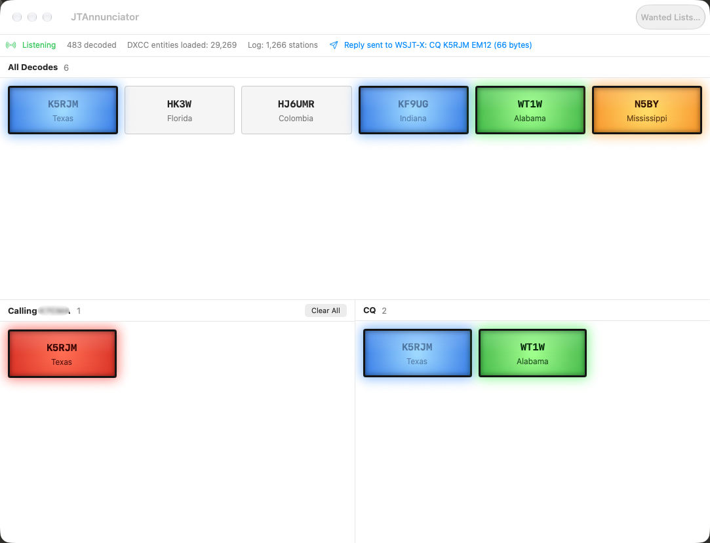

# JTAnnunciator

A native Mac app that listens to [WSJT-X](https://wsjtx.groups.io/g/main)'s UDP protocol and
gives [JTAlert](https://www.dxlabsuite.com/jtalert/)-style visual/audio alerts for the stations
that matter: someone calling you, a wanted callsign, country or state, or a country/state you
haven't worked yet on the current band and mode. JTAlert is Windows-only; [JT-Bridge](https://www.qsl.net/on4kjm/JTBridge/index.html),
its closest Mac analogue, doesn't attempt JTAlert's visual approach. This app exists to bring
that specific thing — a genuinely visual, glanceable "hey, THIS station just showed up" alert —
to macOS.

## Status: working v1, running against live WSJT-X

The app builds and runs on macOS and has been used against a live WSJT-X instance: decodes
arrive over UDP, DXCC lookups resolve from a real cty.dat, and the logbook connection marks
already-worked stations (see the screenshot above). The core protocol/logic layer
(`Sources/JTAnnunciatorCore`) is unit-tested, and `swift test` passes (93 tests, 0 failures).

It hasn't been tried across many WSJT-X versions or unusual setups yet, so the checks in
"Things to verify on a new setup" below are still worth a quick pass on a new install.

## Features

- **Annunciator-style decode grid.** Every decoded station is a box showing its callsign and
  country (or US state/Canadian province once the callbook answers). Boxes light up as colored
  lamps by priority:
  - **Red**: calling you (the message is addressed to your callsign).
  - **Yellow**: on your wanted callsign, DXCC or state lists, and not yet worked.
  - **Blue**: already in your log on the current band and mode (text dimmed).
  - **Amber**: a country, US state or Canadian province you haven't worked on this band and mode.
  - **Green**: calling CQ, and none of the above.
  - **Unlit**: any other decode.

  View → Color Key opens a floating legend. Hovering a box shows details (name, location, grid,
  and worked-before history).
- **Three panes**: All Decodes (cleared each new cycle by default), Calling *your call* (persists
  until you clear a box with right-click or "Clear All"), and CQ.
- **Double-click to reply.** Double-clicking a decode sends WSJT-X a UDP Reply message, the
  same as double-clicking it in WSJT-X itself.
- **Wanted lists** for callsigns, DXCC entities (by cty.dat primary prefix) and US
  states/Canadian provinces. State matching uses the state QRZ reports, so it needs QRZ lookups
  on.
- **Logbook connections** for "worked before", matched on the current band and mode:
  - **MacLoggerDX**: reads its SQLite log (by default `~/Documents/MLDX_Logs/MacLoggerDX.sql`)
    read-only, and re-reads it whenever the file changes.
  - **Wavelog**: pulls QSOs from its `get_contacts_adif` API with a read-only API key and
    station profile ID, polling incrementally so only new contacts are downloaded.
  - Contacts logged in WSJT-X during the session (QSO Logged messages) count too.
- **QRZ.com callbook lookups** (needs a QRZ XML subscription) for name, location, grid and
  state of every decoded station. Lookups are queued one at a time and each callsign is asked
  for once.
- **WSJT-X UDP** over multicast (default group `224.0.0.1`, so other apps can share the feed)
  or plain unicast, on port `2237` by default.
- An alert sound when a wanted station is decoded, switchable in Settings.

Settings has tabs for General (your callsign and grid, clear-per-cycle), Network (UDP port,
multicast group), Notifications (alert sound, Wanted Lists), Lookup (cty.dat file, QRZ
credentials, log connections) and Filters (a placeholder for now).

**Not built yet** (real JTAlert features — see "Possible next steps"):
- Wanted US counties, CQ/ITU zones, continents, LoTW/eQSL status.
- Highlight Callsign and Heartbeat replies to WSJT-X (Reply is the only message sent today).
- Per-category custom alert sounds or text-to-speech callsign announcements.
- Display filters (the Filters tab is empty).
- Picking wanted DXCC entities by country name instead of prefix.
- A real FT8/FT4 message grammar parser (see "Callsign extraction heuristic" below).
- Other loggers besides MacLoggerDX and Wavelog.

## Architecture

- **`Sources/JTAnnunciatorCore/`** — a platform-agnostic Swift package (buildable/testable on
  Linux, no AppKit/SwiftUI/Network.framework dependency), containing everything that doesn't
  need a Mac:
  - `WSJTX/` — `QDataStream.swift` (a reader/writer for Qt's `QDataStream` big-endian wire
    format — the framing every WSJT-X UDP packet uses), `WSJTXMessage.swift` (the message
    types), `WSJTXMessageDecoder.swift` (datagram → `WSJTXMessage`, plus Reply and Heartbeat
    encoders).
  - `DXCC/` — `CTYEntry.swift`/`CTYDatParser.swift` (parses the industry-standard `cty.dat` DXCC
    country-file format), `CallsignParser.swift` (portable-suffix handling, e.g. `G4ABC/VP8`).
  - `Alerts/` — `WantedList.swift`, `FT8MessageParser.swift` (pulls candidate callsigns out of a
    decoded message string), `MessageClassifier.swift` (CQ / calling-me / sender detection),
    `AlertEvent.swift`, `AlertEngine.swift` (the matching logic).
  - `Logbook/` — `LogbookConnection.swift` (the configured loggers), `MacLoggerDXReader.swift`
    (SQLite), `WavelogReader.swift` (HTTP API), `ADIFParser.swift`, `Band.swift`, and
    `WorkedLog.swift` (worked-before by callsign, country and state on a band and mode).
  - `Callbook/` — `CallbookProvider.swift`, `QRZClient.swift` (QRZ XML Data service), and
    `RegionNames.swift` (US state / Canadian province names).
- **`Apps/Mac/JTAnnunciatorMac/`** — the Mac app, a thin SwiftUI layer over
  `JTAnnunciatorCore`. It's a Swift package with an executable target, so `swift run` works, and
  it also has a `project.yml` for [XcodeGen](https://github.com/yonaskolb/XcodeGen), which
  generates `JTAnnunciator.xcodeproj` for a proper `.app` bundle. The generated project is
  git-ignored; regenerate it with `xcodegen` after adding or removing source files.
  - `WSJTXUDPListener.swift` — UDP receiver (multicast via a BSD socket, unicast via
    `Network.framework`), Mac-only. Replies go back on the same socket to the sending WSJT-X
    instance.
  - `AnnunciatorViewModel.swift` — owns the listener, `AlertEngine`, logbook watcher and
    callbook lookups, and publishes state for the UI.
  - `Views/` — `AnnunciatorView` (main window: status bar, the three decode panes, alert
    banner), `AlertBannerView`, `WantedListsView`, `SettingsView` (tabbed, resizable),
    `ColorKeyView` (the floating legend).
  - `Support/` — `AppSettings` (`UserDefaults` persistence), `AlertSoundPlayer` (`NSSound`),
    `ColorCoding` (the lamp colors and their priority).

### Why WSJT-X's UDP protocol, not ADIF-tailing or a log-file watcher

WSJT-X pushes every decode over UDP in real time (its own "Status"/"Decode" messages), which is
both lower-latency and far simpler to consume correctly than watching a log file for appended
lines. This is also exactly what JTAlert itself does on Windows, and what basically every other
WSJT-X companion tool (GridTracker, N1MM's WSJT-X bridge, etc.) does. Field layout for the
message types this app uses was taken directly from WSJT-X's own `Network/NetworkMessage.hpp`
(fetched from a public mirror while writing this), not guessed or reconstructed from
third-party tool behavior.

### DXCC data: why this app doesn't ship a cty.dat

`cty.dat` — the DXCC country-file format almost every ham logging program (N1MM, Log4OM, CQRLOG,
...) uses — has real, non-obvious geographic exceptions (sub-entities sharing a prefix, like
Fiji/Conway Reef/Rotuma all under `3D2`; stations physically located somewhere other than their
callsign prefix suggests). Hand-authoring an accurate table without the ability to validate it
against real-world data would be guessing at exactly the kind of detail that matters most for
this feature to be trustworthy. So `CTYDatParser` implements the parser (grounded against real
`cty.dat` excerpts as test fixtures — see `CTYDatParserTests.swift`), and Settings lets you point
it at whichever `cty.dat` you already trust — the same file your logging program uses. Get one
from your logger's install directory, or from [country-files.com](https://www.country-files.com/).

### Callsign extraction heuristic

Rather than implementing WSJT-X's full standard-messages grammar (`CQ <call> <grid>` vs.
`<call1> <call2> <report>` vs. free text, etc.), `FT8MessageParser` scans every whitespace-
separated token in a decoded message and keeps the ones that look like a callsign (rejecting
grid squares, signal reports, and known protocol keywords like `CQ`/`RR73`/`73`). This means
every message shape alerts correctly on any wanted station present in it, at the cost of
occasionally mis-flagging a token in a free-text message. Fine for v1's alerting purpose; a real
grammar-based parser is a reasonable future improvement, not a correctness blocker.

## Things to verify on a new setup

In rough priority order, since each one gates the next:

1. **`swift build && swift test` from the repo root** — confirm `JTAnnunciatorCore` compiles
   and its tests pass with your toolchain.
2. **`swift run` from `Apps/Mac/JTAnnunciatorMac/`** — confirm the SwiftUI app builds and
   launches.
3. **Point WSJT-X at it**: WSJT-X Settings → Reporting → UDP Server. Use the same address and
   port as this app's Settings → Network: by default multicast group `224.0.0.1`, port `2237`.
   (Clear the multicast group here and use `127.0.0.1` in WSJT-X for plain unicast.) Confirm
   decodes show up, and that double-clicking one makes WSJT-X reply.
4. **Confirm the wire format** matches your WSJT-X version. It has been checked against a live
   WSJT-X install, but not across versions; a schema change would show up as missing or garbled
   decodes.
5. **DXCC lookups against a real cty.dat**: load a real file in Settings and spot-check a few
   known-tricky callsigns (a sub-entity like Conway Reef, a portable call like `G4ABC/VP8`).

## Commands

- Build/test the core package: `swift build`, `swift test` (from the repo root).
- Run the Mac app: `swift run` from `Apps/Mac/JTAnnunciatorMac/`.
- Xcode: run `xcodegen` in `Apps/Mac/JTAnnunciatorMac/`, then open `JTAnnunciator.xcodeproj`.

## Possible next steps

Not a commitment — pick up only what's actually wanted:
- Highlight Callsign (mark stations in WSJT-X's own window) and Heartbeat replies.
- Display filters for the decode grid (the Settings tab is already there).
- Wanted CQ zones/continents/counties and LoTW/eQSL status, matching more of JTAlert's
  categories.
- Search wanted DXCC entities by country name instead of prefix.
- More logbook connections (e.g. an ADIF file, Log4OM, other web loggers).
- Per-category alert sounds or spoken callsign announcements.
- A real FT4/FT8 standard-messages grammar parser, replacing the token-scanning heuristic.
- An app icon, code signing and notarization for distribution.

## License

Released under the MIT License — see [LICENSE](LICENSE).
